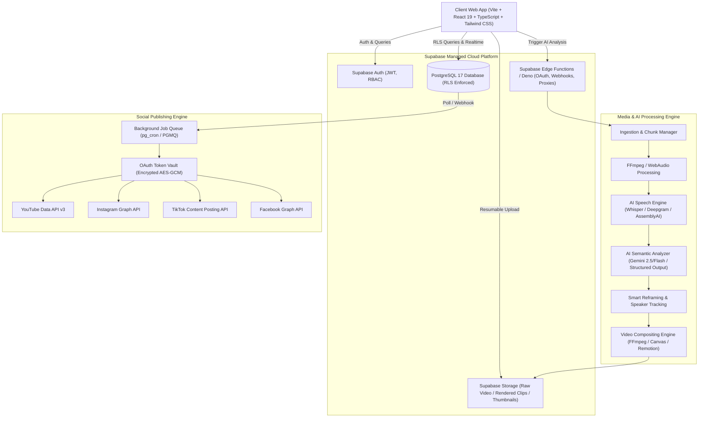
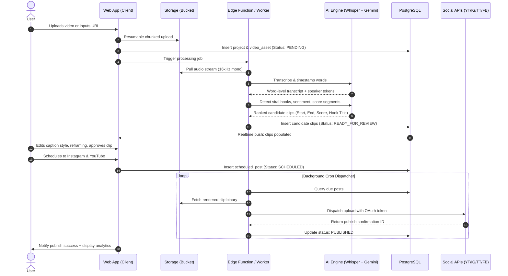

# CLIPGENIUS AI — Technical Architecture & System Design

**Document Version:** 1.0.0  
**Architect:** Principal AI Product Architect  
**Target Environment:** Node.js v24+ / Vite + React 19 / TypeScript / Supabase (PostgreSQL 17 + Auth + Storage + Edge Functions) / FFmpeg & Media Pipeline / Web APIs

---

## 1. System Topology Overview

CLIPGENIUS AI employs a decoupled, event-driven hybrid architecture designed to balance instant client responsiveness with heavy computational workloads (video decoding, transcription, smart reframing, and multi-platform publishing).



---

## 2. Technology Stack Selection & Rationale

| Layer | Selected Technology | Justification |
|---|---|---|
| **Frontend Framework** | **React 19 + Vite + TypeScript** | Ultra-fast HMR, concurrent rendering primitives, type-safe development, lightweight bundle size. |
| **Styling & Design System** | **Tailwind CSS v4 + Motion** | Custom tokenized white-and-red palette, zero-runtime CSS, smooth 60fps micro-animations. |
| **State Management** | **Zustand + TanStack Query** | Minimal boilerplate, persistent store for video editor state, robust server-state caching and deduplication. |
| **In-Browser Video Playhead** | **HTML5 Video + Web Audio API + Canvas** | Frame-accurate synchronization, real-time waveform rendering, dynamic karaoke subtitle overlay without rendering roundtrips. |
| **Backend & Database** | **Supabase (PostgreSQL 17)** | Native Row Level Security (RLS), real-time subscriptions, built-in vector support (`pgvector`), integrated storage, automated backups. |
| **Queue & Scheduling** | **PostgreSQL PGMQ / pg_cron + Edge Functions** | Transactional integrity: jobs are enqueued in the same transaction as state changes, eliminating desyncs. |
| **AI Transcription (STT)** | **Whisper / Deepgram Nova-2** | Sub-word timestamp precision, multi-language support, high accuracy on domain slang/proper nouns. |
| **Semantic & Highlight AI** | **Gemini Flash / Pro (Multimodal)** | High context window (can digest hours of transcript simultaneously), structured JSON schema adherence, low latency, economical token pricing. |
| **Video Compositing & Transcoding** | **FFmpeg Core (Server Worker / WASM Preview)** | Industry standard for stream copy, NVENC/hardware acceleration, complex filtergraphs for burn-in subtitles, aspect ratio padding, and audio ducking. |

---

## 3. Core Processing Pipeline (The 10-Step Video Lifecycle)



---

## 4. Key Architectural Subsystems

### 4.1 In-Browser Non-Destructive Editing Engine
- **Decoupled Preview vs Render:** The browser editor executes non-destructive playback. Cut points, zoom/crop transforms, font sizes, and caption offsets are stored as JSON metadata (`timeline_state`).
- **Zero-Wait Client Feedback:** Changes to subtitle colors, text, or reframing update immediately via CSS transforms and Web Audio gains, eliminating the need for server rendering during the creative phase.
- **Final Render Graph:** Upon approval or manual export request, the client serializes the timeline AST (Abstract Syntax Tree) to the backend render worker, which compiles it into an optimized FFmpeg filtergraph:
  ```bash
  ffmpeg -ss [START] -to [END] -i input.mp4 -vf "crop=ih*9/16:ih:(iw-ow)*[TRACK_X]:0,subtitles=caps.ass:force_style='...'" -af "volume=...,sidechaincompress=..." -c:v libx264 -preset fast -crf 20 -c:a aac output.mp4
  ```

### 4.2 Social OAuth & Token Security Architecture
- Tokens are encrypted at rest using AES-256-GCM.
- Encryption keys reside exclusively in Supabase Vault / server environment secrets, never sent to the browser.
- Client applications interact strictly via opaque account UUIDs (`account_id`).
- When a user initiates OAuth, state parameters are cryptographically signed (HMAC-SHA256) with short expiration to prevent CSRF and session fixation attacks.

### 4.3 Content Calendar & Autonomous Auto-Pilot
- **Autonomous Queue Engine:** Auto-Pilot monitors target accounts, preferred posting windows (e.g., 11:30 AM & 6:00 PM EST), and buffer sizes (e.g., maintain 3 days of approved backlog).
- **Graceful Failure Circuit Breaker:** If a social API rejects a payload (e.g., token expired, media format rejected, rate limit exceeded), the job is tagged `FAILED_RETRYABLE` with an exponential backoff schedule (1m, 5m, 15m, 1h). After 4 failures, it alerts the user and halts further automatic posts on that specific account channel without breaking other pipelines.

---

## 5. Architectural Principles & Invariants

1. **Idempotency Over Everything:** Every background worker task has an idempotent idempotency key (`workspace_id:clip_id:target_platform:scheduled_time`). Re-running a job never produces duplicate social media posts.
2. **Never Block the UI Thread:** Long-running tasks emit server-sent events (SSE) or Supabase Postgres Realtime payloads. The UI transitions through explicit states (`queued`, `processing_transcription`, `generating_clips`, `ready`).
3. **Data Isolation by Default:** Every database table references `workspace_id` with active PostgreSQL Row Level Security (RLS). Cross-workspace data leakage is physically blocked at the database engine level.
4. **Transparent Degradation:** If cloud AI services encounter throttling or downtime, users can still manually trim, split, add custom subtitles, and schedule exports without AI assistance.
