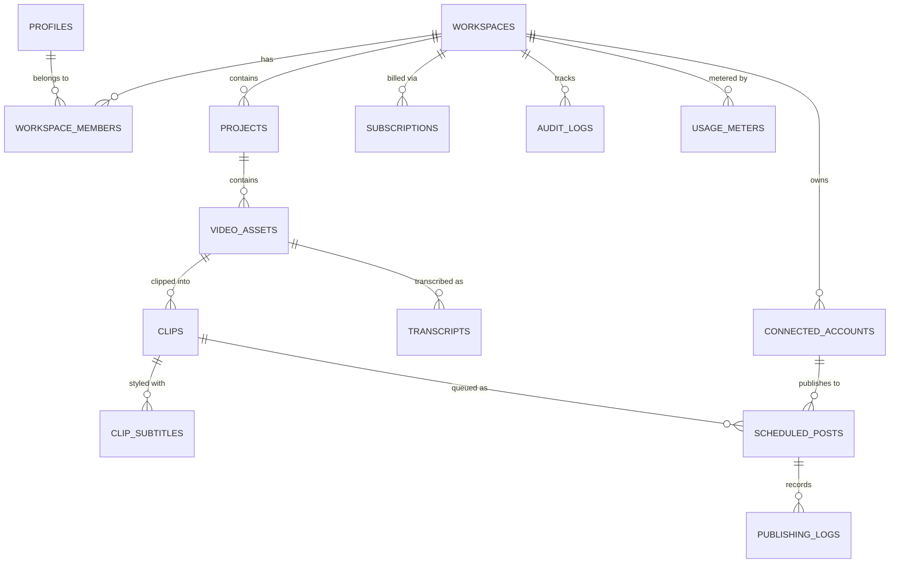

# CLIPGENIUS AI — Database Architecture & Schema Specification

**Document Version:** 1.0.0  
**Database Engine:** PostgreSQL 17 (Supabase Managed)  
**Security Model:** Comprehensive Row Level Security (RLS) on all user-facing and tenant tables.

---

## 1. Entity-Relationship Overview



---

## 2. Enumerated Types (Enums)

```sql
-- Workspace & Membership Roles
CREATE TYPE workspace_role AS ENUM ('owner', 'admin', 'editor', 'reviewer', 'viewer');

-- Video Processing Status
CREATE TYPE asset_status AS ENUM ('uploading', 'pending', 'transcribing', 'analyzing', 'completed', 'failed');

-- Clip Processing & Review Status
CREATE TYPE clip_status AS ENUM ('draft', 'ready', 'pending_approval', 'approved', 'rejected', 'archived');

-- Aspect Ratio Configurations
CREATE TYPE aspect_ratio_mode AS ENUM ('9:16', '1:1', '16:9', '4:5');

-- Social Media Platforms
CREATE TYPE social_platform AS ENUM ('youtube', 'instagram', 'tiktok', 'facebook');

-- Publishing Pipeline Status
CREATE TYPE post_status AS ENUM ('draft', 'scheduled', 'publishing', 'published', 'failed', 'cancelled');

-- Subscription Tiers
CREATE TYPE subscription_tier AS ENUM ('free', 'creator', 'pro', 'agency');
```

---

## 3. Core Database Tables

### 3.1 `profiles`
User identity and authentication metadata linked to `auth.users`.
```sql
CREATE TABLE public.profiles (
    id UUID PRIMARY KEY REFERENCES auth.users(id) ON DELETE CASCADE,
    email TEXT NOT NULL UNIQUE,
    full_name TEXT,
    avatar_url TEXT,
    created_at TIMESTAMPTZ NOT NULL DEFAULT timezone('utc', now()),
    updated_at TIMESTAMPTZ NOT NULL DEFAULT timezone('utc', now())
);
```

### 3.2 `workspaces`
Tenant boundary for multi-user collaboration and client agency isolation.
```sql
CREATE TABLE public.workspaces (
    id UUID PRIMARY KEY DEFAULT gen_random_uuid(),
    name TEXT NOT NULL,
    slug TEXT NOT NULL UNIQUE,
    logo_url TEXT,
    owner_id UUID NOT NULL REFERENCES public.profiles(id) ON DELETE RESTRICT,
    created_at TIMESTAMPTZ NOT NULL DEFAULT timezone('utc', now()),
    updated_at TIMESTAMPTZ NOT NULL DEFAULT timezone('utc', now())
);

CREATE INDEX idx_workspaces_owner ON public.workspaces(owner_id);
```

### 3.3 `workspace_members`
Role assignment within workspaces.
```sql
CREATE TABLE public.workspace_members (
    id UUID PRIMARY KEY DEFAULT gen_random_uuid(),
    workspace_id UUID NOT NULL REFERENCES public.workspaces(id) ON DELETE CASCADE,
    user_id UUID NOT NULL REFERENCES public.profiles(id) ON DELETE CASCADE,
    role workspace_role NOT NULL DEFAULT 'editor',
    invited_at TIMESTAMPTZ NOT NULL DEFAULT timezone('utc', now()),
    joined_at TIMESTAMPTZ,
    UNIQUE(workspace_id, user_id)
);

CREATE INDEX idx_workspace_members_user ON public.workspace_members(user_id);
CREATE INDEX idx_workspace_members_ws ON public.workspace_members(workspace_id);
```

### 3.4 `projects`
Organizational folder for video sources and campaigns.
```sql
CREATE TABLE public.projects (
    id UUID PRIMARY KEY DEFAULT gen_random_uuid(),
    workspace_id UUID NOT NULL REFERENCES public.workspaces(id) ON DELETE CASCADE,
    name TEXT NOT NULL,
    description TEXT,
    color_tag TEXT DEFAULT '#E54848',
    created_by UUID REFERENCES public.profiles(id) ON DELETE SET NULL,
    created_at TIMESTAMPTZ NOT NULL DEFAULT timezone('utc', now()),
    updated_at TIMESTAMPTZ NOT NULL DEFAULT timezone('utc', now())
);

CREATE INDEX idx_projects_workspace ON public.projects(workspace_id);
```

### 3.5 `video_assets`
Source long-form video files and stream metadata.
```sql
CREATE TABLE public.video_assets (
    id UUID PRIMARY KEY DEFAULT gen_random_uuid(),
    workspace_id UUID NOT NULL REFERENCES public.workspaces(id) ON DELETE CASCADE,
    project_id UUID REFERENCES public.projects(id) ON DELETE SET NULL,
    title TEXT NOT NULL,
    source_type TEXT NOT NULL CHECK (source_type IN ('upload', 'youtube', 'vimeo', 'drive', 'url')),
    source_url TEXT,
    storage_path TEXT,
    duration_seconds NUMERIC(10, 2),
    resolution_width INTEGER,
    resolution_height INTEGER,
    fps NUMERIC(6, 2),
    file_size_bytes BIGINT,
    status asset_status NOT NULL DEFAULT 'pending',
    error_message TEXT,
    metadata JSONB DEFAULT '{}'::jsonb,
    created_by UUID REFERENCES public.profiles(id) ON DELETE SET NULL,
    created_at TIMESTAMPTZ NOT NULL DEFAULT timezone('utc', now()),
    updated_at TIMESTAMPTZ NOT NULL DEFAULT timezone('utc', now())
);

CREATE INDEX idx_video_assets_ws_status ON public.video_assets(workspace_id, status);
CREATE INDEX idx_video_assets_project ON public.video_assets(project_id);
```

### 3.6 `transcripts`
Word-level transcription and speaker diarization data.
```sql
CREATE TABLE public.transcripts (
    id UUID PRIMARY KEY DEFAULT gen_random_uuid(),
    video_asset_id UUID NOT NULL UNIQUE REFERENCES public.video_assets(id) ON DELETE CASCADE,
    language TEXT NOT NULL DEFAULT 'en',
    full_text TEXT NOT NULL,
    words JSONB NOT NULL, -- Array of [{word: "...", start: 0.12, end: 0.45, speaker: 1, confidence: 0.98}]
    speakers JSONB NOT NULL DEFAULT '[]'::jsonb, -- Array of [{speaker_id: 1, label: "Host"}]
    created_at TIMESTAMPTZ NOT NULL DEFAULT timezone('utc', now())
);
```

### 3.7 `clips`
Generated or custom-cut highlights derived from video assets.
```sql
CREATE TABLE public.clips (
    id UUID PRIMARY KEY DEFAULT gen_random_uuid(),
    workspace_id UUID NOT NULL REFERENCES public.workspaces(id) ON DELETE CASCADE,
    video_asset_id UUID NOT NULL REFERENCES public.video_assets(id) ON DELETE CASCADE,
    title TEXT NOT NULL,
    summary TEXT,
    hook_sentence TEXT,
    virality_score INTEGER CHECK (virality_score BETWEEN 0 AND 100),
    virality_breakdown JSONB DEFAULT '{}'::jsonb, -- {hook: 92, pacing: 85, emotional_peak: 78}
    start_time NUMERIC(10, 2) NOT NULL,
    end_time NUMERIC(10, 2) NOT NULL,
    duration_seconds NUMERIC(10, 2) GENERATED ALWAYS AS (end_time - start_time) STORED,
    aspect_ratio aspect_ratio_mode NOT NULL DEFAULT '9:16',
    crop_coordinates JSONB DEFAULT '{"x": 0.5, "y": 0.5, "zoom": 1.0}'::jsonb,
    status clip_status NOT NULL DEFAULT 'ready',
    rendered_storage_path TEXT,
    thumbnail_storage_path TEXT,
    timeline_state JSONB DEFAULT '{}'::jsonb, -- Nondestructive editor cuts, music volume, b-roll
    created_by UUID REFERENCES public.profiles(id) ON DELETE SET NULL,
    created_at TIMESTAMPTZ NOT NULL DEFAULT timezone('utc', now()),
    updated_at TIMESTAMPTZ NOT NULL DEFAULT timezone('utc', now())
);

CREATE INDEX idx_clips_workspace ON public.clips(workspace_id);
CREATE INDEX idx_clips_asset ON public.clips(video_asset_id);
CREATE INDEX idx_clips_status ON public.clips(status);
```

### 3.8 `clip_subtitles`
Subtitle styling, animation presets, and active text overrides.
```sql
CREATE TABLE public.clip_subtitles (
    id UUID PRIMARY KEY DEFAULT gen_random_uuid(),
    clip_id UUID NOT NULL UNIQUE REFERENCES public.clips(id) ON DELETE CASCADE,
    style_preset TEXT NOT NULL DEFAULT 'hormozi_bold', -- 'hormozi_bold', 'mrbeast_pop', 'minimal_clean'
    font_family TEXT NOT NULL DEFAULT 'Inter',
    font_size INTEGER NOT NULL DEFAULT 32,
    font_color TEXT NOT NULL DEFAULT '#FFFFFF',
    highlight_color TEXT NOT NULL DEFAULT '#E54848',
    stroke_color TEXT NOT NULL DEFAULT '#000000',
    stroke_width INTEGER NOT NULL DEFAULT 4,
    position_y_percent NUMERIC(5, 2) NOT NULL DEFAULT 75.0,
    words_per_batch INTEGER NOT NULL DEFAULT 3,
    custom_cues JSONB, -- Overridden word timing / spelling edits
    created_at TIMESTAMPTZ NOT NULL DEFAULT timezone('utc', now()),
    updated_at TIMESTAMPTZ NOT NULL DEFAULT timezone('utc', now())
);
```

### 3.9 `connected_accounts`
Social media OAuth credentials and channel connection states.
```sql
CREATE TABLE public.connected_accounts (
    id UUID PRIMARY KEY DEFAULT gen_random_uuid(),
    workspace_id UUID NOT NULL REFERENCES public.workspaces(id) ON DELETE CASCADE,
    platform social_platform NOT NULL,
    platform_account_id TEXT NOT NULL,
    account_name TEXT NOT NULL,
    account_handle TEXT,
    avatar_url TEXT,
    encrypted_access_token TEXT NOT NULL,
    encrypted_refresh_token TEXT,
    token_expires_at TIMESTAMPTZ,
    scopes TEXT[] NOT NULL DEFAULT '{}',
    is_active BOOLEAN NOT NULL DEFAULT true,
    last_health_check TIMESTAMPTZ NOT NULL DEFAULT timezone('utc', now()),
    health_status TEXT NOT NULL DEFAULT 'healthy',
    created_at TIMESTAMPTZ NOT NULL DEFAULT timezone('utc', now()),
    updated_at TIMESTAMPTZ NOT NULL DEFAULT timezone('utc', now()),
    UNIQUE(workspace_id, platform, platform_account_id)
);

CREATE INDEX idx_connected_accounts_ws ON public.connected_accounts(workspace_id);
```

### 3.10 `scheduled_posts`
Content calendar queue for automated or manual publishing.
```sql
CREATE TABLE public.scheduled_posts (
    id UUID PRIMARY KEY DEFAULT gen_random_uuid(),
    workspace_id UUID NOT NULL REFERENCES public.workspaces(id) ON DELETE CASCADE,
    clip_id UUID NOT NULL REFERENCES public.clips(id) ON DELETE CASCADE,
    account_id UUID NOT NULL REFERENCES public.connected_accounts(id) ON DELETE CASCADE,
    title TEXT,
    caption TEXT NOT NULL,
    tags TEXT[] DEFAULT '{}',
    scheduled_for TIMESTAMPTZ NOT NULL,
    status post_status NOT NULL DEFAULT 'scheduled',
    platform_post_id TEXT,
    platform_post_url TEXT,
    requires_approval BOOLEAN NOT NULL DEFAULT false,
    approved_by UUID REFERENCES public.profiles(id) ON DELETE SET NULL,
    approved_at TIMESTAMPTZ,
    retry_count INTEGER NOT NULL DEFAULT 0,
    max_retries INTEGER NOT NULL DEFAULT 3,
    last_error TEXT,
    created_by UUID REFERENCES public.profiles(id) ON DELETE SET NULL,
    created_at TIMESTAMPTZ NOT NULL DEFAULT timezone('utc', now()),
    updated_at TIMESTAMPTZ NOT NULL DEFAULT timezone('utc', now())
);

CREATE INDEX idx_scheduled_posts_due ON public.scheduled_posts(status, scheduled_for) 
    WHERE status IN ('scheduled', 'publishing');
CREATE INDEX idx_scheduled_posts_workspace ON public.scheduled_posts(workspace_id);
```

### 3.11 `publishing_logs`
Immutable audit log of all publishing dispatches and responses.
```sql
CREATE TABLE public.publishing_logs (
    id UUID PRIMARY KEY DEFAULT gen_random_uuid(),
    scheduled_post_id UUID NOT NULL REFERENCES public.scheduled_posts(id) ON DELETE CASCADE,
    attempt_number INTEGER NOT NULL,
    request_payload JSONB,
    response_payload JSONB,
    http_status INTEGER,
    error_details TEXT,
    dispatched_at TIMESTAMPTZ NOT NULL DEFAULT timezone('utc', now())
);

CREATE INDEX idx_publishing_logs_post ON public.publishing_logs(scheduled_post_id);
```

### 3.12 `subscriptions` & `usage_meters`
Commercial billing, credit management, and rate limiting.
```sql
CREATE TABLE public.subscriptions (
    id UUID PRIMARY KEY DEFAULT gen_random_uuid(),
    workspace_id UUID NOT NULL UNIQUE REFERENCES public.workspaces(id) ON DELETE CASCADE,
    tier subscription_tier NOT NULL DEFAULT 'free',
    stripe_customer_id TEXT UNIQUE,
    stripe_subscription_id TEXT UNIQUE,
    status TEXT NOT NULL DEFAULT 'active',
    current_period_start TIMESTAMPTZ NOT NULL DEFAULT timezone('utc', now()),
    current_period_end TIMESTAMPTZ NOT NULL,
    cancel_at_period_end BOOLEAN NOT NULL DEFAULT false,
    created_at TIMESTAMPTZ NOT NULL DEFAULT timezone('utc', now()),
    updated_at TIMESTAMPTZ NOT NULL DEFAULT timezone('utc', now())
);

CREATE TABLE public.usage_meters (
    id UUID PRIMARY KEY DEFAULT gen_random_uuid(),
    workspace_id UUID NOT NULL REFERENCES public.workspaces(id) ON DELETE CASCADE,
    billing_period_start TIMESTAMPTZ NOT NULL,
    minutes_transcribed NUMERIC(10, 2) NOT NULL DEFAULT 0,
    clips_exported INTEGER NOT NULL DEFAULT 0,
    posts_published INTEGER NOT NULL DEFAULT 0,
    storage_bytes_used BIGINT NOT NULL DEFAULT 0,
    updated_at TIMESTAMPTZ NOT NULL DEFAULT timezone('utc', now()),
    UNIQUE(workspace_id, billing_period_start)
);
```

---

## 4. Row Level Security (RLS) Policies Strategy

All tables enforce RLS:
```sql
-- Helper function to verify workspace membership
CREATE OR REPLACE FUNCTION public.is_workspace_member(_workspace_id UUID, _user_id UUID)
RETURNS BOOLEAN SECURITY DEFINER STABLE AS $$
BEGIN
    RETURN EXISTS (
        SELECT 1 FROM public.workspace_members
        WHERE workspace_id = _workspace_id AND user_id = _user_id
    );
END;
$$ LANGUAGE plpgsql;

-- Example: clips table RLS
ALTER TABLE public.clips ENABLE ROW LEVEL SECURITY;

CREATE POLICY "Workspace members can view clips"
ON public.clips FOR SELECT
USING (public.is_workspace_member(workspace_id, auth.uid()));

CREATE POLICY "Workspace editors and above can insert/update clips"
ON public.clips FOR ALL
USING (
    EXISTS (
        SELECT 1 FROM public.workspace_members
        WHERE workspace_id = clips.workspace_id 
        AND user_id = auth.uid()
        AND role IN ('owner', 'admin', 'editor')
    )
);
```
