# CLIPGENIUS AI — Master Project Plan & Roadmap

**Document Version:** 1.0.0  
**Status:** Ready for Phase 1 Kickoff  
**Architecture Lead:** Principal AI Product Architect

---

## 1. Implementation Phases & Milestones

```mermaid
flowchart LR
    P0["Phase 0<br/>Audit & Blueprint"] --> P1["Phase 1<br/>Product Foundation"]
    P1 --> P2["Phase 2<br/>Core Video & AI Engine"]
    P2 --> P3["Phase 3<br/>Studio Editor Suite"]
    P3 --> P4["Phase 4<br/>Social Integrations"]
    P4 --> P5["Phase 5<br/>AI Auto-Pilot"]
    P5 --> P6["Phase 6<br/>Calendar & Analytics"]
    P6 --> P7["Phase 7<br/>Commercial & Team"]
    P7 --> P8["Phase 8<br/>Hardening & Launch"]
```

---

### Phase 0: Audit, Requirements & Architecture (Current Milestone)
- **Status:** **Completed**
- **Deliverables:**
  - Full codebase inspection and environment assessment.
  - Comprehensive architectural specifications and data models.
  - Initialized documentation suite (`REQUIREMENTS.md`, `ARCHITECTURE.md`, `DATABASE.md`, `PERMISSIONS.md`, `DESIGN.md`, `COMPONENTS.md`, `INTEGRATIONS.md`, `TESTING.md`, `AGENTS.md`, `PROGRESS.md`, `PROJECT_PLAN.md`).
- **Exit Criteria:** Architecture approved by product owner.

---

### Phase 1: Product Foundation & Core Infrastructure
- **Focus:** Scaffolding the modern React 19 + TypeScript + Vite + Tailwind CSS v4 application, Supabase database schema, and navigation shell.
- **Key Deliverables:**
  - Application shell with white-and-red design tokens (`#FFFFFF`, `#FAFAFA`, `#E54848`, `#C93636`, `#FFF1F0`).
  - Desktop sidebar + Mobile-first 5-tab navigation (`Home | Create | Projects | Calendar | Profile`).
  - Central "What do you want to create today?" interactive dashboard hero with the 3 primary action paths.
  - Supabase Auth integration (Email/Password + Google OAuth) and profile management.
  - Workspace management, project folders, and multi-tenant RLS schema deployment.
- **Exit Criteria:** Users can authenticate, switch workspaces, create projects, and navigate responsive desktop/mobile shells smoothly.

---

### Phase 2: Core Video Creation & AI Pipeline
- **Focus:** Ingestion, transcription, highlight detection, and candidate clip generation.
- **Key Deliverables:**
  - Multi-source video ingestion (local chunked file upload + YouTube/URL input).
  - Audio extraction and speech-to-text integration with word-level timestamps and speaker diarization.
  - Semantic moment detection and virality scoring engine (Hook, Pacing, Insight, Sentiment).
  - Candidate clip cards grid with hover video preview and virality breakdown gauge.
- **Exit Criteria:** A 15-minute video can be ingested, transcribed, and produce 5-10 scored candidate highlight clips with full word-level transcripts.

---

### Phase 3: Professional Web Editing Suite (Studio)
- **Focus:** Frame-accurate video preview, interactive timeline, subtitle customization, and reframing.
- **Key Deliverables:**
  - Multi-track in-browser timeline with trimming handles, split points, and waveform view.
  - Dynamic vertical (9:16) smart reframing with draggable speaker tracking anchor.
  - Subtitle styling studio with live karaoke-style word highlighting and viral presets (Hormozi, MrBeast, Minimal Clean).
  - Audio ducking, background music selector, and speed ramping controls.
  - High-resolution video export queue.
- **Exit Criteria:** User can scrub timeline with $<50\text{ms}$ latency, customize subtitle styles with instant preview, and generate clean MP4 exports.

---

### Phase 4: Social Media Accounts & OAuth Infrastructure
- **Focus:** Secure multi-platform OAuth connection, token storage, and publishing API dispatchers.
- **Key Deliverables:**
  - Secure OAuth connection flows for YouTube Data API, Instagram Graph API, TikTok Posting API, and Facebook Pages.
  - AES-256-GCM encrypted token vault in Supabase.
  - Account health monitoring, expiration tracking, and automatic token refresh.
  - Direct video publishing dispatchers with platform-specific validation.
- **Exit Criteria:** Users can connect accounts securely and publish or schedule clips to Instagram Reels and YouTube Shorts without exposing tokens.

---

### Phase 5: AI Auto-Pilot & Autonomous Pipeline
- **Focus:** Hands-free background workflow from raw video to scheduled social posts.
- **Key Deliverables:**
  - Auto-Pilot configuration wizard (source channel, clip count, target accounts, schedule cadence, approval rules).
  - Background orchestrator that ingests new videos, detects clips, generates titles/hashtags, and populates the schedule.
  - Client approval portal with tokenized shareable review links.
  - Idempotent queue worker with automatic retry handling.
- **Exit Criteria:** Auto-Pilot autonomously turns an uploaded long video into scheduled social posts awaiting client approval.

---

### Phase 6: Content Calendar & Authentic Analytics
- **Focus:** Multi-platform scheduling calendar and verified metrics.
- **Key Deliverables:**
  - Drag-and-drop weekly and monthly Content Calendar.
  - Publishing audit logs with status tracking (`Scheduled`, `Publishing`, `Published`, `Failed`).
  - Real analytics dashboard querying official platform APIs (views, likes, comments, shares, retention).
  - Clear distinction between actual platform metrics and zero/unavailable values.
- **Exit Criteria:** Users can drag-and-drop posts on the calendar to reschedule, view audit logs, and inspect real platform engagement metrics.

---

### Phase 7: Commercial Infrastructure, Subscriptions & Teams
- **Focus:** Monetization, credit metering, usage quotas, and agency client management.
- **Key Deliverables:**
  - Tiered plan provisioning (Free, Creator, Pro, Agency) via Stripe Checkout & Customer Portal.
  - Granular credit ledger tracking transcribed minutes, export counts, and active social channels.
  - Team seats with role-based permissions (Owner, Admin, Editor, Reviewer, Viewer).
- **Exit Criteria:** Credit deductions occur accurately in real time; non-paying accounts are gracefully constrained when quotas are reached.

---

### Phase 8: Production Hardening, Quality Assurance & Launch
- **Focus:** End-to-end testing, performance optimization, security audit, and deployment.
- **Key Deliverables:**
  - Automated test suite (Vitest + React Testing Library + Playwright E2E).
  - Comprehensive RLS security audit and penetration check.
  - Asset optimization, CDN caching, and lazy loading.
  - Production deployment documentation and disaster recovery playbooks.
- **Exit Criteria:** All automated tests pass, zero high/critical vulnerabilities, and production build deployed.
